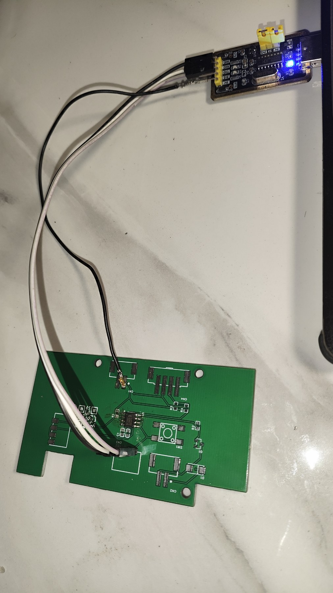
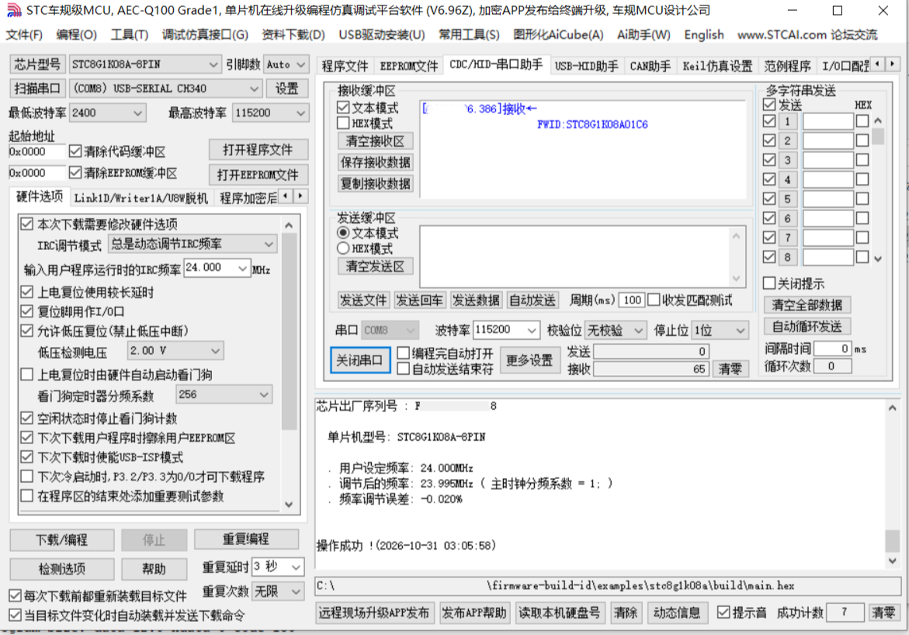

# STC8G1K08A FWID 示例

这是 [`firmware-build-id`](../../README.md) 的一个最小端到端示例：STC8G1K08A 每次复位通过 UART1 打印一行 `FWID:<body>`；构建后把镜像和源码快照按 ID 存档；之后从设备读出的 ID 可以取回对应源码。

示例 ID：`FWID:STC8G1K08A01C6`（仅用于演示，正式构建必须重新生成）。

## 它做什么

1. `src/main.c` 把 `FWID:STC8G1K08A01C6` 放在 8051 代码区，复位后从 P3.1 以 115200 8N1 输出。
2. `tools/verify_image.py` 解码 Keil 生成的 Intel HEX，在镜像字节里查找 FWID，计算 SHA-256。
3. `tools/make_archive.py` 生成本地存档：`record.json`、`source.tar.gz`、`artifacts/main.bin`、`artifacts/main.hex`。
4. `tools/read_fwid.py` 从串口或 stdin 读 ID，校验 CRC，再校验存档记录和哈希。

覆盖 SPEC 的 ID 格式、镜像内嵌、构建后检索、构建记录、本地 archive profile、设备输出和取回流程。不覆盖签名、加密、安全启动、产线 UID 记录、远程 HTTP/Git 存档等可选/Production 内容。

## 目录

```
examples/stc8g1k08a/
├── README.md
├── stc8g1k08a.uvproj         # Keil C51 工程（STC8G1K08 Series）
├── docs/
│   ├── wiring.jpg            # 上板接线
│   └── stc-isp-output.png    # STC-ISP 下载与串口回读
├── src/
│   ├── main.c                 # UART 输出 FWID
│   ├── stc8g1k08a.h           # 本示例用到的 SFR
│   └── fwid_generated.h       # 由 tools/fwid.py 生成
├── tools/
│   ├── fwidlib.py             # ID 规范化、CRC、HEX 解码
│   ├── fwid.py                # 生成/校验 ID，写头文件
│   ├── verify_image.py        # 构建后检索 FWID、算哈希
│   ├── make_archive.py        # 本地存档 + read-after-write
│   ├── read_fwid.py           # 串口/stdin 读 ID，校验存档
│   └── requirements.txt       # 只有串口读取需要 pyserial
└── .gitignore
```

`build/`、`archive/` 以及 Keil 的 `Objects/`、`Listings/`、`STARTUP.A51`、`*.uvopt`、`*.uvgui.*` 是本地产物，默认不提交。工程使用 Keil 自带的启动代码，不依赖根目录的 `STARTUP.A51`。

## 接线

| STC8G1K08A | USB-TTL |
| --- | --- |
| VCC | 3.3V 或 5V（与板子一致） |
| GND | GND |
| P3.1 / TXD | RXD |
| P3.0 / RXD | TXD（本示例只发送；接上便于以后加查询命令） |
| P3.2 | 10k 上拉到 VCC（建议） |

P3.0/P3.1/P3.2 在上电时同时为低可能进入 ISP 等待模式，P3.2 上拉可以避开这个问题。8 脚封装的引脚号因 SOP8/DIP8 而异，按信号名接线。

## 时钟与波特率

`main.c` 默认 24 MHz、115200。STC-ISP 下载时也要把 IRC 设为 24 MHz；两者不一致会乱码。

STC8G1K08A-8PIN 没有 Timer2，串口波特率使用 Timer1 模式 0（16 位自动重载）作为 UART1 的波特率时钟：`AUXR.T1x12=1`、`AUXR.S1ST2=0`。

| FOSC | BAUD | T1_RELOAD |
| --- | --- | --- |
| 24 MHz | 115200 | `0xFFCC` |
| 11.0592 MHz | 115200 | `0xFFE8` |
| 24 MHz | 9600 | `0xFD8F` |

如果改频率，改 `main.c` 里的 `FOSC` 后重新编译。重载值由 `65536 - FOSC / (4 * BAUD)` 计算。

## 快速开始

以下命令都在本目录执行。

### 1. 确认或生成 FWID

仓库自带的演示 ID 可以直接用：

```bash
python tools/fwid.py check FWID:STC8G1K08A01C6
```

正式构建前生成新 ID：

```bash
python tools/fwid.py new --header src/fwid_generated.h
```

它会输出两行，例如：

```
FWID:XXXXXXXXXXXXXX
FWID:XXXX-XXXX-XXXX-XX
```

第一行是规范形式，记下来；第二行只用于人读。生成后必须重新编译，否则镜像里还是旧 ID。

### 2. Keil 构建

仓库带一个 Keil C51 工程：

1. 用 Keil uVision 打开 `stc8g1k08a.uvproj`。工程目标为 `STC8G1K08 Series`、Small 模式，输出到 `build/`。
2. 如果器件列表里没有 `STC8G1K08 Series`，用 STC-ISP 的“Keil 仿真设置”把 STC 器件库加入 Keil；也可以把 Device 改成 `8XC52`。本示例只使用标准 8051 SFR 和 `src/stc8g1k08a.h` 里的 STC8G SFR。
3. Build（F7）。生成的 HEX 是 `build/main.hex`。

工程使用 Keil 自带的 `LIB\STARTUP.A51` / `C51S.LIB` 启动代码。`src/stc8g1k08a.h` 只定义了本示例用到的 STC8G 寄存器；不要同时包含完整的 `STC8G.H`，否则 SFR 可能重复定义。如果 Keil 报找不到 `fwid_generated.h`，检查 Include Paths 是否包含 `src`（工程已设为 `.\src`）。

### 3. 构建后校验

```bash
python tools/verify_image.py build/main.hex \
  --expect FWID:STC8G1K08A01C6 \
  --bin-out build/main.bin
```

输出类似：

```
image: build/main.hex (hex), base=0x0000, size=2218
payload_sha256: <64 hex>
file_sha256:    <64 hex>
found: FWID:STC8G1K08A01C6 at payload offset 0x87F
wrote build/main.bin
```

本机 Keil C51 9.61 构建结果为 `0 Error(s), 0 Warning(s)`，`Program Size: data=13.0 xdata=0 code=173`；上面的 `size` 和 `offset` 是这次构建的实测值，不同 Keil 版本可能略有差异。

`payload_sha256` 是 Intel HEX 解码后的实际代码字节哈希；`file_sha256` 是 `.hex` 文本文件本身的哈希。构建记录使用前者。

### 4. 存档（烧录前）

```bash
python tools/make_archive.py \
  --image build/main.hex \
  --fwid FWID:STC8G1K08A01C6
```

生成：

```
archive/STC8G1K08A01C6/
├── record.json
├── source.tar.gz
└── artifacts/
    ├── main.bin
    └── main.hex
```

`source.tar.gz` 打包 `src/`、`tools/`、`README.md`、`stc8g1k08a.uvproj` 等，排除 `build/`、`archive/`、`.git/`、`__pycache__/` 以及 Keil 的 `Objects/`、`Listings/`、`STARTUP.A51`、`*.uvopt`、`*.uvgui.*`。脚本会先确认镜像里确实有该 FWID，写入后再做一次 read-after-write 校验：重新读 `record.json`，核对快照包和镜像的 SHA-256。

如果 `archive/<body>/record.json` 已存在，且快照包或镜像的哈希与现有记录不同，脚本会拒绝覆盖并返回非零。同一个 ID 不能对应两份不同内容；新构建请生成新 ID。

按 SPEC 的核心不变式，先存档再烧录；存档失败时不要烧录这个镜像。

### 5. 烧录与串口

用 STC-ISP 选择 HEX、IRC 24 MHz，下载。打开串口 115200 8N1，按一下复位，应看到：

```
FWID:STC8G1K08A01C6
```

如果只看到乱码，先检查 STC-ISP 的 IRC 频率和 `FOSC` 是否都是 24 MHz。

**实测（2026-10-31）**：STC-ISP V6.96Z 选择 `STC8G1K08A-8PIN`，IRC 设定 24.000 MHz（实测 23.995 MHz，误差 -0.020%），COM8、115200 8N1。下载成功后串口收到 `FWID:STC8G1K08A01C6`。





### 6. 取回

```bash
python tools/read_fwid.py --port COM5 --archive archive
```

Linux/macOS 把端口换成 `/dev/ttyUSB0`。没有 pyserial 时：

```bash
python -m pip install -r tools/requirements.txt
```

也可以不接串口，直接把 ID 喂给脚本：

```bash
echo FWID:STC8G1K08A01C6 | python tools/read_fwid.py --stdin --archive archive
```

脚本会校验 CRC、`record.json` 的 `fwid`、`source.tar.gz` 的 SHA-256，以及 `artifacts/main.bin` 的 SHA-256。

## 与 SPEC 的对应

| SPEC | 示例 |
| --- | --- |
| 4.1–4.4 ID 格式与校验 | `tools/fwidlib.py`、`tools/fwid.py` |
| 5.3 明文嵌入镜像 | `src/main.c` 的 `code` 数组 |
| 5.4 构建后检索与哈希 | `tools/verify_image.py` |
| 6 构建记录 | `tools/make_archive.py` 生成的 `record.json` |
| 7.4 本地 profile | `archive/<body>/record.json`、`source.tar.gz`、`artifacts/` |
| 8.1 设备输出 | UART 输出 `FWID:<body>\r\n` |
| 9 取回与校验 | `tools/read_fwid.py` |

这是 Core 的一个最小子集，不是完整一致性声明。

## 说明与限制

- **演示 ID 不唯一**。`FWID:STC8G1K08A01C6` 只用于让示例开箱即用；同一个 ID 不得对应不同镜像。正式构建每次都要运行 `fwid.py new`。
- **快照顺序**。示例为了简单，在构建后用 `make_archive.py` 打包当前源码，并假设构建后源码没有变化。严格的 snapshot-first 应当先创建快照、从快照构建、再把同一份快照存档（SPEC 5.1/5.2）。正式接入时不要跳过这一步。
- **实际烧录字节**。STC-ISP 可能在下载时填充或修改字节。如果实际烧录的内容与 `artifacts/main.bin` 不一致，必须把实际烧录产物存档并更新记录（SPEC 5.4/5.6）。
- **没有敏感信息扫描**。示例源码不含密钥，但正式项目应按 SPEC 5.7 扫描后再存档。
- **没有访问控制和审计**。本地存档默认靠文件系统权限；HTTP/Git profile 需要额外实现。
- **没有可复现构建验证**。Keil C51 的构建结果未验证可复现；`record.json` 中 `build.reproducible` 为 `false`。
- **没有产线 UID 记录**。设备 UID ↔ FWID 的绑定属于 Production profile。
- **已在 STC8G1K08A-8PIN 上烧录验证**。Keil C51 9.61 / uVision 5.38 构建结果为 `0 Error(s), 0 Warning(s)`，`code=173` 字节；`build/main.hex` 中能找到 FWID。STC-ISP V6.96Z 下载成功，COM8、115200 8N1 收到 `FWID:STC8G1K08A01C6`，见上方接线和串口截图。
- **快照包用 gzip**。Python 3.12 标准库没有 zstd；SPEC 允许 `source.tar.gz`。
